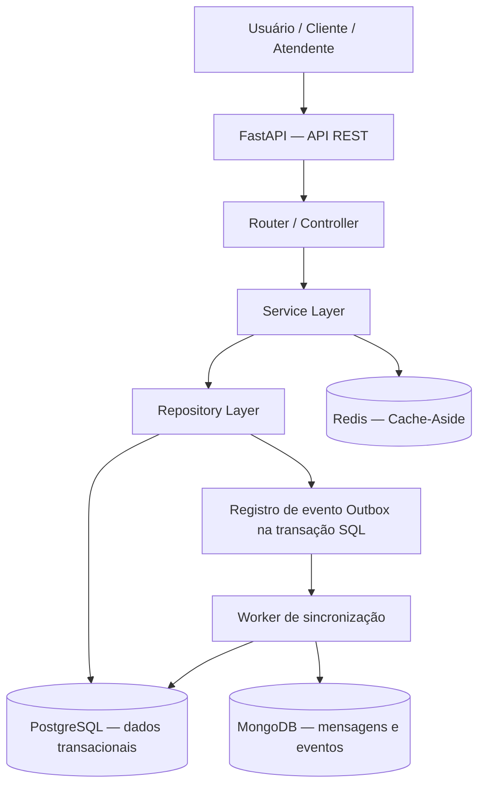

# NEXORA — Arquitetura do Sistema

## 1. Visão geral

O NEXORA é um sistema de atendimento omnichannel desenvolvido com uma arquitetura em camadas, buscando separar as responsabilidades da aplicação e facilitar sua manutenção.

A aplicação utiliza FastAPI para disponibilizar os endpoints REST e integra três tecnologias de armazenamento: PostgreSQL, MongoDB e Redis.

O PostgreSQL concentra os dados relacionais e transacionais, o MongoDB armazena mensagens e eventos dos atendimentos, e o Redis é utilizado como mecanismo de cache.

### 1.1. Diagrama da arquitetura

O diagrama representa o fluxo lógico entre os componentes. O registro Outbox faz parte da transação no PostgreSQL, enquanto o worker realiza o processamento posterior dos eventos.

## 2. Organização em camadas

### 2.1. Router / Controller

Responsável por receber as requisições HTTP, encaminhar os dados para a camada de serviço e retornar as respostas da API.

A validação dos dados de entrada é realizada com o auxílio do Pydantic.

### 2.2. Service Layer

Concentra as regras de negócio e coordena as operações da aplicação.

Entre suas responsabilidades estão a validação das informações recebidas, o processamento das operações relacionadas aos chamados e a coordenação do acesso aos mecanismos de persistência.

### 2.3. Repository Layer

Responsável pelas operações de acesso aos dados relacionais.

Essa separação evita concentrar as consultas SQL diretamente nos endpoints e facilita a manutenção do código.

## 3. Tecnologias e responsabilidades

| Tecnologia | Responsabilidade |
|---|---|
| FastAPI | Disponibilização da API REST |
| PostgreSQL | Dados relacionais, integridade referencial e transações ACID |
| MongoDB | Armazenamento documental de mensagens e eventos |
| Redis | Cache temporário de consultas |
| Worker | Processamento assíncrono dos eventos Outbox |
| Docker Compose | Organização e execução dos serviços da aplicação |

### 3.1. PostgreSQL

Armazena os dados estruturados dos clientes, colaboradores, departamentos, chamados e eventos Outbox.

O banco utiliza mecanismos como chaves primárias, chaves estrangeiras, restrições, índices, views, triggers e stored procedures.

As operações transacionais utilizam as propriedades ACID para preservar a consistência dos registros.

### 3.2. MongoDB

Armazena o histórico documental de mensagens e eventos relacionados aos atendimentos.

O uso de documentos permite representar conteúdos e metadados com maior flexibilidade.

A associação com os chamados ocorre por meio do identificador `ticket_id`.

### 3.3. Redis

Atua como armazenamento temporário para consultas de chamados.

O Redis não substitui o PostgreSQL como fonte principal das informações.

As entradas possuem tempo de expiração configurável por meio de `CACHE_TTL_SECONDS`.

### 3.4. Worker

É responsável por consultar os eventos pendentes na tabela `outbox_events`, executar o processamento correspondente no MongoDB e atualizar a situação do evento no PostgreSQL.

O campo `event_id` é utilizado como identificador para auxiliar no processamento idempotente, evitando a criação de documentos duplicados quando um evento precisa ser reprocessado.

## 4. Fluxo de criação de chamados

O fluxo de criação de um chamado ocorre da seguinte maneira:

1. O usuário envia uma requisição `POST /tickets` para a API.
2. O Router recebe a solicitação e valida os dados com Pydantic.
3. A Service Layer aplica as regras de negócio e verifica as referências necessárias.
4. A Repository Layer realiza as operações de persistência no PostgreSQL.
5. O chamado e seu evento Outbox são registrados na mesma transação.
6. Após a confirmação da transação, o worker poderá identificar o evento pendente.
7. O worker processa o evento no MongoDB e registra sua conclusão no PostgreSQL.

O processamento assíncrono permite que a integração documental ocorra sem exigir uma transação distribuída entre PostgreSQL e MongoDB.

## 5. Transactional Outbox

O padrão Transactional Outbox foi utilizado para organizar a comunicação assíncrona entre o PostgreSQL e o MongoDB.

Ao registrar uma operação relevante, a aplicação também armazena um evento na tabela `outbox_events`, dentro da mesma transação PostgreSQL.

Esse mecanismo permite que a alteração principal e o registro do evento sejam confirmados ou revertidos conjuntamente.

Posteriormente, o worker consulta os eventos pendentes e executa o processamento necessário.

### 5.1. Tratamento de falhas

Caso o worker consiga registrar o documento no MongoDB, mas falhe antes de marcar o evento como processado no PostgreSQL, o evento poderá ser processado novamente.

Para reduzir o risco de duplicações, o sistema utiliza `event_id` como identificador idempotente.

Dessa forma, o processamento pode ser repetido sem necessariamente criar novos documentos para o mesmo evento.

## 6. Estratégia Cache-Aside

O Redis utiliza a estratégia Cache-Aside para otimizar a consulta de chamados.

O funcionamento ocorre da seguinte maneira:

1. A API recebe uma requisição para consultar um chamado.
2. Verifica se existe uma entrada correspondente no Redis.
3. Se a entrada existir, retorna os dados do cache (`HIT`).
4. Se não existir, consulta o PostgreSQL (`MISS`).
5. O resultado é armazenado temporariamente no Redis.
6. As consultas seguintes podem reutilizar os dados enquanto a entrada estiver válida.

As informações armazenadas no Redis possuem tempo de vida definido por TTL.

Em operações que modificam os dados, a aplicação deve invalidar ou atualizar as entradas correspondentes para reduzir o risco de retornar informações desatualizadas.

## 7. Consistência dos dados

O NEXORA utiliza diferentes estratégias de consistência conforme a tecnologia envolvida.

### 7.1. Consistência transacional

As operações realizadas no PostgreSQL são protegidas pelas propriedades ACID.

A criação do chamado e o registro do evento Outbox são realizados dentro da mesma transação.

### 7.2. Consistência eventual

PostgreSQL e MongoDB não participam de uma transação distribuída.

A sincronização ocorre posteriormente, por meio do worker.

Por esse motivo, pode existir um intervalo entre a confirmação da operação no PostgreSQL e a disponibilização do documento correspondente no MongoDB.

### 7.3. Consistência do cache

O Redis mantém cópias temporárias de informações que possuem origem no PostgreSQL.

O TTL e os mecanismos de invalidação ajudam a controlar a utilização de informações desatualizadas.

## 8. Organização dos serviços com Docker

A aplicação utiliza Docker Compose para organizar a execução dos componentes.

Os cinco serviços principais são:

- `nexora-api`: aplicação FastAPI.
- `nexora-postgres`: banco de dados PostgreSQL.
- `nexora-mongo`: banco de dados MongoDB.
- `nexora-redis`: serviço de cache Redis.
- `nexora-worker`: processamento dos eventos Outbox.

A separação em serviços permite executar os componentes de maneira organizada e facilita a configuração do ambiente de desenvolvimento.

## 9. Organização do código

A estrutura do projeto utiliza arquivos específicos