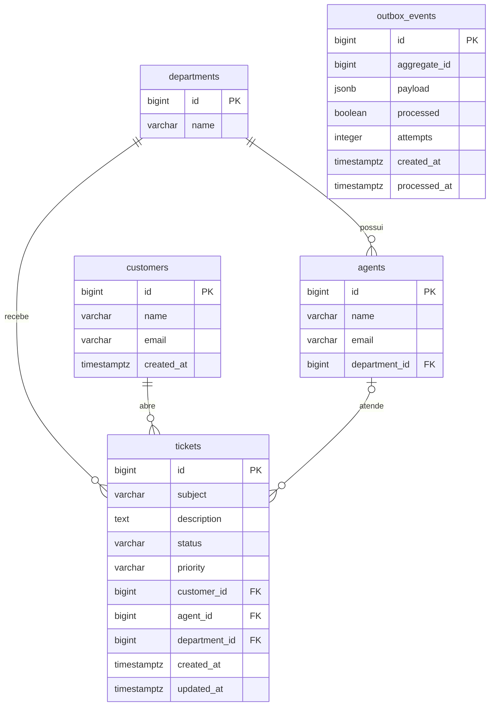

# NEXORA — Modelo de Dados

## 1. Introdução

O NEXORA é um sistema de atendimento omnichannel desenvolvido como projeto da disciplina de Banco de Dados II.

Sua estrutura de dados utiliza três tecnologias: PostgreSQL, MongoDB e Redis. O PostgreSQL é responsável pelas informações relacionais, o MongoDB pelo armazenamento documental das mensagens e o Redis pelo armazenamento temporário de dados consultados com frequência.

Este documento apresenta as entidades, seus atributos, os relacionamentos e as decisões de modelagem adotadas no projeto.

## 2. Modelo relacional — PostgreSQL

O banco de dados PostgreSQL do NEXORA é composto por cinco tabelas principais:

- `customers`: cadastro dos clientes.
- `agents`: cadastro dos colaboradores responsáveis pelos atendimentos.
- `departments`: departamentos da organização.
- `tickets`: chamados registrados no sistema.
- `outbox_events`: eventos utilizados no processamento assíncrono.

### 2.1. Tabela customers

Armazena os dados cadastrais dos clientes.

| Campo | Tipo | Obrigatório | Descrição |
|---|---|---|---|
| id | BIGINT | Sim | Identificador único do cliente (PK) |
| name | VARCHAR | Sim | Nome do cliente |
| email | VARCHAR | Sim | E-mail do cliente |
| created_at | TIMESTAMPTZ | Sim | Data e hora do cadastro |

A chave primária é `id`. O campo `email` possui restrição de unicidade.

### 2.2. Tabela agents

Armazena os colaboradores responsáveis pelos atendimentos.

| Campo | Tipo | Obrigatório | Descrição |
|---|---|---|---|
| id | BIGINT | Sim | Identificador único do colaborador (PK) |
| name | VARCHAR | Sim | Nome do colaborador |
| email | VARCHAR | Sim | E-mail do colaborador |
| department_id | BIGINT | Sim | Departamento do colaborador (FK) |

O campo `department_id` referencia `departments.id`, estabelecendo o relacionamento entre colaboradores e departamentos.

### 2.3. Tabela departments

Armazena os departamentos utilizados para organizar os atendimentos.

| Campo | Tipo | Obrigatório | Descrição |
|---|---|---|---|
| id | BIGINT | Sim | Identificador único do departamento (PK) |
| name | VARCHAR | Sim | Nome do departamento |

Os departamentos previstos na carga inicial são Comercial, Suporte, Financeiro, Implantação e Relacionamento.

### 2.4. Tabela tickets

Armazena os chamados registrados no sistema.

| Campo | Tipo | Obrigatório | Descrição |
|---|---|---|---|
| id | BIGINT | Sim | Identificador único do chamado (PK) |
| subject | VARCHAR | Sim | Assunto |
| description | TEXT | Sim | Descrição |
| status | VARCHAR | Sim | Situação do chamado |
| priority | VARCHAR | Sim | Prioridade |
| customer_id | BIGINT | Sim | Cliente relacionado (FK) |
| agent_id | BIGINT | Não | Colaborador responsável (FK) |
| department_id | BIGINT | Sim | Departamento responsável (FK) |
| created_at | TIMESTAMPTZ | Sim | Data e hora de criação |
| updated_at | TIMESTAMPTZ | Sim | Data e hora da última atualização |

Os campos `customer_id`, `agent_id` e `department_id` representam relacionamentos com outras entidades.

O campo `agent_id` aceita valores nulos, permitindo cadastrar chamados ainda não atribuídos a um colaborador.

### 2.5. Tabela outbox_events

Armazena os eventos utilizados na integração assíncrona entre os componentes da aplicação.

| Campo | Tipo | Descrição |
|---|---|---|
| id | BIGINT | Identificador único do evento (PK) |
| aggregate_id | BIGINT | Identificador do registro relacionado |
| payload | JSONB | Dados necessários ao processamento |
| processed | BOOLEAN | Indica se o evento foi processado |
| attempts | INTEGER | Quantidade de tentativas registradas |
| created_at | TIMESTAMPTZ | Data e hora de criação |
| processed_at | TIMESTAMPTZ | Data e hora de processamento |

Além dos campos apresentados, a estrutura de eventos possui informações que identificam o tipo de operação registrada.

O campo `aggregate_id` representa uma associação lógica ao registro relacionado, não necessariamente uma chave estrangeira para a tabela `tickets`.

## 3. Relacionamentos e cardinalidades

O modelo relacional apresenta os seguintes relacionamentos:

| Entidades | Cardinalidade | Descrição |
|---|---|---|
| departments → agents | 1:N | Um departamento pode possuir vários colaboradores |
| departments → tickets | 1:N | Um departamento pode receber vários chamados |
| customers → tickets | 1:N | Um cliente pode possuir vários chamados |
| agents → tickets | 1:N | Um colaborador pode ser responsável por vários chamados |

Cada chamado pertence a um cliente e a um departamento.

Um chamado pode possuir um colaborador responsável ou permanecer sem atribuição.

## 4. Diagrama Entidade-Relacionamento (DER)

O diagrama a seguir apresenta as entidades do PostgreSQL, seus principais atributos e os relacionamentos existentes.



A entidade `outbox_events` é apresentada separadamente porque sua associação com os registros do sistema é lógica, baseada nos eventos, e não depende de uma chave estrangeira obrigatória para `tickets`.

## 5. Normalização até a Terceira Forma Normal (3FN)

A estrutura relacional foi organizada considerando os princípios de normalização para reduzir redundâncias e evitar inconsistências.

### 5.1. Primeira Forma Normal (1FN)

As tabelas possuem chaves primárias e campos que armazenam valores individuais.

Por exemplo, a tabela `customers` separa nome e e-mail em atributos próprios. A tabela `tickets` mantém assunto, descrição, status e prioridade em campos distintos.

### 5.2. Segunda Forma Normal (2FN)

As entidades utilizam chaves primárias simples, identificadas pelo campo `id`.

Dessa maneira, não existem dependências parciais de atributos em relação a partes de uma chave primária composta.

### 5.3. Terceira Forma Normal (3FN)

As informações cadastrais de clientes, colaboradores e departamentos são armazenadas em tabelas específicas.

Na tabela `tickets`, são mantidos identificadores como `customer_id`, `agent_id` e `department_id`, em vez de repetir nomes, e-mails e outros dados cadastrais.

Essa organização contribui para evitar anomalias de atualização, inserção e exclusão.

O departamento responsável pelo chamado é registrado separadamente do departamento ao qual pertence o colaborador, permitindo representar essas duas informações de negócio de forma independente.

A análise completa da 3FN considera também as dependências funcionais e as regras de negócio aplicáveis a cada tabela.

## 6. Chaves e restrições de integridade

O modelo utiliza mecanismos de integridade para garantir a consistência das informações.

**Chaves primárias (PK):** identificam unicamente os registros de cada entidade.

**Chaves estrangeiras (FK):** estabelecem vínculos entre clientes, colaboradores, departamentos e chamados.

**Restrições UNIQUE:** impedem a duplicação de valores definidos como únicos, como os e-mails cadastrados.

**Restrições CHECK:** permitem limitar os valores aceitos em determinados campos.

**Restrições NOT NULL:** identificam os atributos cujo preenchimento é obrigatório.

Esses mecanismos contribuem para preservar a integridade referencial e a validade dos registros.

## 7. Modelagem documental — MongoDB

O MongoDB é utilizado para armazenar as mensagens associadas aos atendimentos.

A coleção principal é denominada `messages`.

A modelagem documental permite representar mensagens com diferentes conteúdos e metadados, conforme a necessidade de cada atendimento.

### 7.1. Estrutura dos documentos

Entre os campos utilizados estão:

| Campo | Descrição |
|---|---|
| _id | Identificador do documento no MongoDB |
| event_id | Identificador do evento de sincronização |
| ticket_id | Identificador do chamado |
| sender_type | Tipo de remetente |
| sender_id | Identificador do remetente |
| content | Conteúdo da mensagem |
| channel | Canal de atendimento |
| created_at | Data e hora de criação, quando registrada |

Os documentos podem conter outros metadados conforme a estrutura utilizada pela aplicação.

### 7.2. Exemplo de documento

```json
{
  "event_id": 5,
  "ticket_id": 100001,
  "content": "oi, tudo bem?"
}
```

O exemplo apresenta uma mensagem relacionada ao chamado `100001`, identificada pelo evento `5`.

O campo `event_id` permite relacionar o documento ao evento utilizado no processamento assíncrono e pode contribuir para o controle de duplicações.

### 7.3. Relação com o PostgreSQL

O MongoDB não utiliza uma chave estrangeira relacional para estabelecer o vínculo com a tabela `tickets`.

A associação é realizada por meio do campo `ticket_id`, que corresponde ao identificador do chamado armazenado no PostgreSQL.

Essa abordagem permite manter o histórico de mensagens em uma estrutura documental, preservando os dados estruturados dos chamados no banco relacional.

## 8. Estrutura de cache — Redis

O Redis é utilizado para armazenar temporariamente informações dos chamados.

As chaves seguem o padrão:

`ticket:{id}`

Por exemplo:

`ticket:2`

Nesse caso, a chave representa o conteúdo temporariamente armazenado para o chamado de identificador 2.

O Redis não substitui o PostgreSQL como fonte principal dos dados relacionais. Sua finalidade é disponibilizar informações frequentemente consultadas com menor necessidade de acesso ao banco principal.

A aplicação utiliza a estratégia Cache-Aside, descrita em detalhes no documento `ARQUITETURA.md`.

## 9. Considerações finais

O modelo de dados do NEXORA combina diferentes estruturas de armazenamento de acordo com a natureza das informações.

O PostgreSQL concentra as entidades relacionais e utiliza mecanismos de integridade para manter os registros consistentes.

O MongoDB armazena as mensagens dos atendimentos em documentos, oferecendo flexibilidade para diferentes conteúdos e metadados.

O Redis é utilizado como armazenamento temporário para consultas frequentes.

A separação dessas responsabilidades permite aplicar conceitos de modelagem relacional, normalização, integridade referencial, armazenamento documental e persistência poliglota em um mesmo projeto.

Os detalhes da comunicação entre os componentes estão documentados em `ARQUITETURA.md`, enquanto os testes e resultados de desempenho estão registrados em `VALIDACAO_E_BENCHMARK.md`.